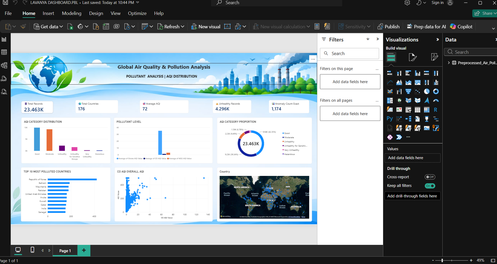

# Global Air Quality & Pollution Analysis

**Subject:** Data Visualization and Preprocessing\
**Domain:** Environment \| Air Quality\
**Project:** Global Air Quality & Pollution Analysis\
**Tools:** Python (dataset preprocessing reflected in the supplied CSV),
Power BI

## Problem Statement

Air pollution affects human health and environmental quality. This
project explores air quality measurements across countries and cities,
compares major pollutant indicators, and highlights locations with
higher AQI values. The Power BI dashboard presents the results through
summary cards, charts, and a geographic view.

## Objectives

-   Examine AQI values and AQI categories across countries and cities.
-   Compare the AQI indicators for CO, Ozone, NO2, and PM2.5.
-   Identify countries with higher recorded AQI values.
-   Explore the distribution of air quality categories.
-   Highlight records marked as anomalies in the prepared dataset.
-   Present the findings in an interactive Power BI report.

## Dataset

**File:** `Preprocessed_Air_Pollution(2).csv`

The supplied dataset contains **23,463 records and 24 columns**,
covering **176 countries** and 23,463 city entries.

Important fields include:

-   `Country`, `City`
-   `AQI Value`, `AQI Category`, `AQI Level`
-   `CO AQI Value`, `CO AQI Category`
-   `Ozone AQI Value`, `Ozone AQI Category`
-   `NO2 AQI Value`, `NO2 AQI Category`
-   `PM2.5 AQI Value`, `PM2.5 AQI Category`
-   Encoded category columns
-   Scaled AQI and pollutant value columns
-   `Anomaly` --- anomaly label supplied in the prepared dataset

The CSV inspection found **no missing values and no duplicate rows**.

## Tools Used

-   **Power BI** --- dashboard creation and data visualization
-   **CSV dataset** --- prepared air pollution data
-   **Python / Pandas** --- dataset inspection and summary calculations

## Dashboard

The Power BI dashboard is titled **Global Air Quality & Pollution
Analysis**.

It contains the following summary cards and visuals:

### KPI Cards

-   Total Records
-   Total Countries
-   Average AQI
-   Unhealthy Records
-   Anomaly Count

### Visualizations

1.  **AQI Category Distribution** --- compares the number of records in
    each AQI category.
2.  **Pollutant Level Comparison** --- compares average AQI values for
    CO, Ozone, and NO2 as shown in the report.
3.  **AQI Category Proportion** --- donut chart showing the share of
    each AQI category.
4.  **Top 10 Most Polluted Countries** --- horizontal bar chart ranking
    countries by the AQI measure used in the dashboard.
5.  **CO AQI vs Overall AQI** --- scatter chart exploring the
    relationship between CO AQI and overall AQI.
6.  **Country Map** --- geographic view of the country-level records.

## Key Findings

-   The dataset contains **23,463 records** from **176 countries**.
-   The average overall AQI value is approximately **72.01**.
-   AQI values range from **6 to 500**.
-   **Good** is the largest AQI category with **9,936 records
    (42.35%)**.
-   **Moderate** is the second-largest category with **9,231 records
    (39.34%)**.
-   The remaining categories are Unhealthy (**2,227**), Unhealthy for
    Sensitive Groups (**1,591**), Very Unhealthy (**287**), and
    Hazardous (**191**).
-   The average pollutant AQI values in the supplied dataset are: CO
    **1.37**, Ozone **35.19**, NO2 **3.06**, and PM2.5 **68.52**.
-   The `Anomaly` column contains **1,174 records labelled -1** and
    **22,289 records labelled 1**. The dashboard displays the 1,174
    records as the anomaly count.

## Conclusion

The analysis provides a global overview of air quality using overall AQI
and individual pollutant indicators. The dashboard makes it easier to
compare AQI categories, inspect country-level patterns, and explore the
relationship between CO AQI and overall AQI. The results can support
awareness of air pollution patterns and help identify areas that may
need closer attention.

## Project Files

Add the following files to this GitHub repository:

-   `README.md` --- project overview and dashboard documentation
-   `Preprocessed_Air_Pollution(2).csv` --- prepared dataset
-   `dashboard.png` --- Power BI dashboard screenshot
-   `Air_Pollution_Dashboard.pbix` --- Power BI report file (if
    available)

------------------------------------------------------------------------

*Note: The numerical findings above are calculated from the supplied
CSV. Dashboard descriptions are based on the dashboard screenshot
provided. The screenshot does not show slicers, a what-if parameter,
forecasting, or an AI visual, so these features are not claimed here.*
